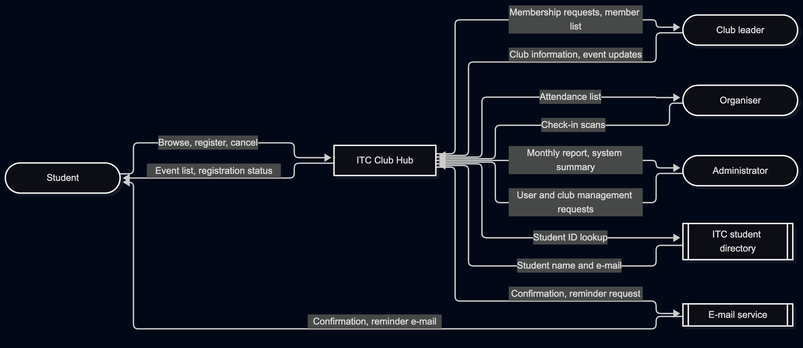
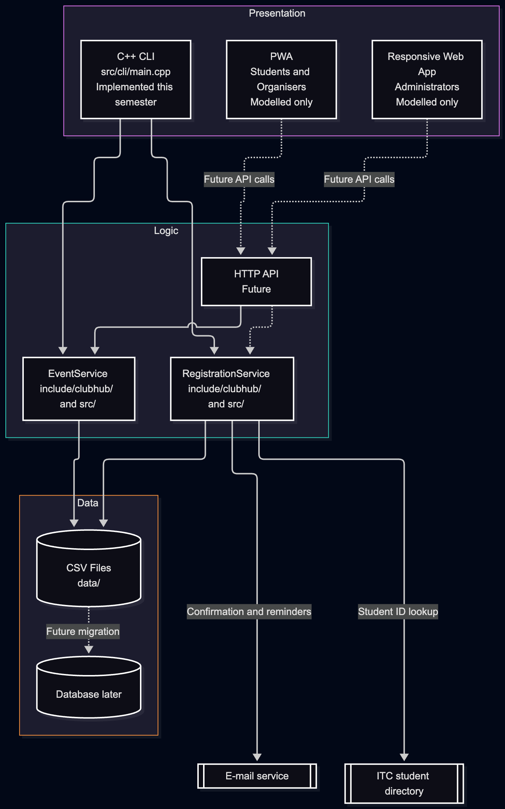

Lab-02 · System Design (v1.0, 2026-11-08)

1. Lab-02 Files

|File	                |Description	                                                |Main Author     |
|:----------------------|:--------------------------------------------------------------|:---------------|
|`lab02/app-classification.md`|Implements the event management core.	                        |Keo Maknioddom|
|`lab02/app-quadrant.mmd`     |Implements the event management core.	                        |Keo Maknioddom|
|`lab02/adr-001-application-type.md`	|Mermaid source code for the Club Hub context diagram.	        | Techsamnang Monyrak|
|`lab02/quality-scenarios.md `	|PNG export of the context diagram.	                            |Pres Samchara|
|`lab02/context-diagram.mmd`	    |Mermaid source code for the three-tier architecture diagram.	|Tim Rommnea|
|`lab02/context-diagram.png`	    |Mermaid source code for the three-tier architecture diagram.	|Tim Rommnea|
|`lab02/architecture.mmd`	    |PNG export of the three-tier architecture diagram.	            |Tim Rommnea|
|`lab02/architecture.png`	    |PNG export of the three-tier architecture diagram.	            |Tim Rommnea|
|`lab02/challenge/offline-checkin.md`	|Implements the event management core.	                        |Pres Samchara|
|`lab02/README.md`	            |Documents Lab-02 files, reused inputs, diagrams, and changes.	|Tim Rommnea, Chea Sovannareach, Techsamnang Monyrak |
|`include/clubhub/event.hpp  `	|Implements the event management core.	                        |Chea Sovannareach|
|`include/clubhub/event_csv.hpp`	        |Implements the list-events command-line interface.	            |Chea Sovannareach|
|`include/clubhub/queued_checkin.hpp `	            |Documents Lab-02 files, reused inputs, diagrams, and changes.	|Tim Rommnea|
|` src/event.cpp, src/event_csv.cpp`	            |Documents Lab-02 files, reused inputs, diagrams, and changes.	|Chea Sovannareach|
|`src/cli/main.cpp `	            |Documents Lab-02 files, reused inputs, diagrams, and changes.	|Chea Sovannareach|
|` data/events.csv  `	            |Documents Lab-02 files, reused inputs, diagrams, and changes.	|Pres Samchara|
|` CMakeLists.txt`	            |Documents Lab-02 files, reused inputs, diagrams, and changes.	|Keo Maknioddom|
1. Inputs Reused

|Lab-01 File             |Version / Commit Hash	|How It Was Used                                            |
|:----------------------|:----------------------|:----------------------------------------------------------|
|`lab01/team-charter.md`	|3265603       	|Used as a reference for team roles and responsibilities.   |
|`lab01/decisions.md`	    |3265603	    |Used as a reference for previous project decisions.        |

1. Diagrams

## 1. Context Diagram

This diagram shows the Club Hub system, its users,
external systems, and the data flowing between them.

## 2. Three-Tier Architecture

This diagram shows the three layers of Club Hub:
Presentation, Logic, and Data.

4. Change Log

|Date	|Version	|Changes     |Authors   |
|:------|:----------|:----------------------------------------------------------|:----------------|
|2026-11-08	|1.0	|Completed Lab-02 documentation, system diagrams, event core, and list-events CLI.	|Everyone|