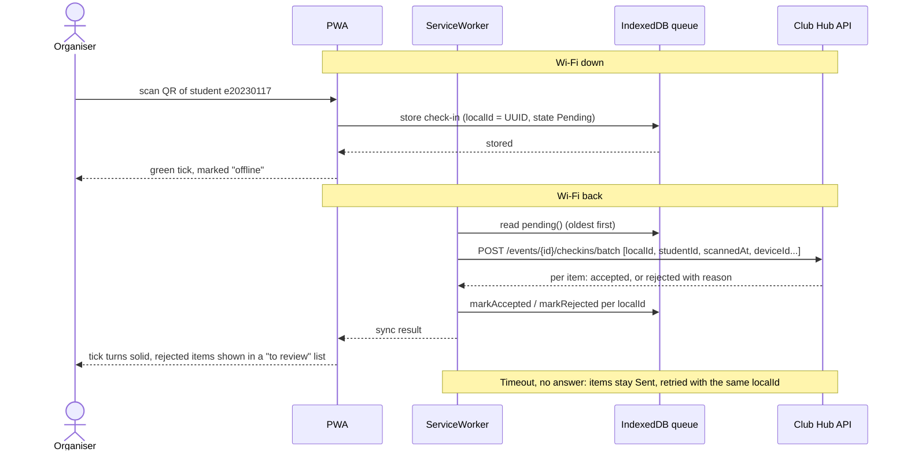

# Challege: offline-first check-in for the Club Hub PWA

## 1. Sequence Diagram

## 2. Conflict Rules

| # | Case | Winner | Organiser sees | Stored on the server |
|---|------|--------|----------------|----------------------|
| 1 | Same student scanned at door 1 and door 2. | The scan with the earliest corrected time wins. If both times are the same, the smaller deviceId wins. | Both phones show a green tick at first. After syncing, the losing scan shows "Already checked in at door 1, 08:30". | One attendance record is saved (student, event, winning localid, and corrected time). The duplicate scan is saved in the audit log with reason "ALREADY CHECKED IN". |
| 2 | Registration cancelled on the server before the scan is synced. | The server wins because it has the latest registration information. | After syncing, the item turns red and shows "Registration cancelled, check this student manually". The organiser can decide whether to allow a walk-in. | No attendance record is saved. An audit log entry is saved with reason "REGISTRATION CANCELLED",   " localid", and times. |
| 3 | Student is not registered for the event. | The server decides whether the student is registered. | Offline: an orange tick shows "Not on the list, will be checked later". After syncing: a red message shows "Not registered". | No attendance record is saved. An audit log entry is saved with reason " Not REGISTERED". A walk-in must be a separate action, not automatic. |
| 4 | Upload is retried after a timeout, but the server has already saved it. | The first check-in accepted by the server wins. | The organiser sees "Accepted" again. No new check-in is created. | The server checks the "localid" first. If the same "localid" is sent again, the server returns "Accepted" without creating a duplicate record. |
| 5 | The phone clock is 7 minutes wrong. | The server time is used to decide the correct order. | If the clock is wrong by more than 5 minutes, the organiser sees a warning: "Phone clock is about 7 minutes wrong". | The server saves "scannedAtDevice" (phone scan time), "receivedAt" (server time), and "skewestimate = receivedAt - deviceNowUpload". It calculates " scannedAtCorrected = scannedAtDevice + skewEstimate" to decide rule #1. A scan outside the event time after correction is accepted but marked "CLOCK SUSPECT". |

